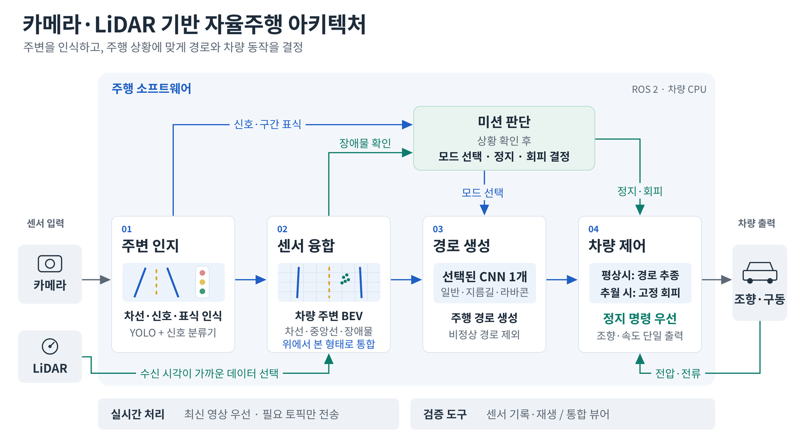

# 카메라·LiDAR 융합 자율주행 시스템

1/10 스케일 차량(Xycar)에서 **카메라·LiDAR 인식 → 미터 단위 BEV → 상황별 경로 CNN → 경로 검사 → 조향·속도 제어**를 하나의 ROS 2 주행 소프트웨어로 연결한 프로젝트입니다.
국민대학교 자율주행 경진대회 본선에서 전체 코스를 완주했습니다(예선 130팀 중 본선 진출, 본선 22팀 중 8위).

> 이 폴더는 대회 차량 소프트웨어 중 **인지·판단·제어 핵심 모듈과 테스트, 실행 설정**만 발췌한 것입니다.
> 학습된 모델 가중치, 녹화 데이터, 차량 제조사 제공 드라이버는 포함하지 않았습니다.

▶ **본선 주행 영상:** [제9회 국민대학교 자율주행 경진대회 AI - 엣지챌린지 공식 영상 (4:24:32 ~ 4:27:32)](https://www.youtube.com/watch?v=CcfXS3UFL0A&t=15872s)



## 목차

1. [시스템 구성](#1-시스템-구성)
2. [문제와 원인 → 해결 과정 → 결과](#2-문제와-원인--해결-과정--결과)
   - [2.1 카메라 기하: 렌즈 왜곡까지 되짚는 BEV](#21-카메라-기하-렌즈-왜곡까지-되짚는-bev)
   - [2.2 센서 융합: LiDAR를 넣자 오히려 나빠진 경로](#22-센서-융합-lidar를-넣자-오히려-나빠진-경로)
   - [2.3 실시간 영상 처리: 50 ms이던 검출이 181 ms로](#23-실시간-영상-처리-50-ms이던-검출이-181-ms로)
   - [2.4 경로 검사: 잘못된 경로가 제어로 넘어가지 않게](#24-경로-검사-잘못된-경로가-제어로-넘어가지-않게)
   - [2.5 추월: 유연성 대신 반복 가능한 동작](#25-추월-유연성-대신-반복-가능한-동작)
   - [2.6 모터 제어: 계측으로 출발 조건 결정](#26-모터-제어-계측으로-출발-조건-결정)
3. [검증 환경](#3-검증-환경)
4. [디렉터리 구조](#4-디렉터리-구조)
5. [빌드와 테스트](#5-빌드와-테스트)

---

## 1. 시스템 구성

| 단계 | 하는 일 | 주요 파일 |
|---|---|---|
| **인지** | YOLO segmentation으로 흰 차선·노란 중앙선·신호등·라바콘 구간 표식을 검출하고, 마스크를 차량 기준 미터 좌표 BEV로 변환 | `yolo_bev_node.py`, `bev_geometry.py` |
| **센서 융합** | LiDAR 점을 같은 BEV 격자에 투영하고, 카메라 시각과 가장 가까운 scan만 결합 | `lidar_geometry.py`, `lidar_compact.py`, `road_lidar_filter.py` |
| **판단** | 일반·지름길·추월·라바콘 4개 경로 CNN 중 현재 모드에 맞는 모델 하나만 실행, 신호·구간 미션 관리 | `cnn_path_node.py`, `cnn_modes.py`, `path_model.py`, `signal_mission.py` |
| **경로 검사** | CNN 경로의 유효점 수·길이·좌우 범위·기울기·곡률을 검사해 비정상 경로 차단 | `path_contract.py` |
| **제어** | Lookahead 기반 조향, IIR smoothing, 속도 slew ramp, 결정론적 추월 블록. 모터 명령은 이 노드 하나만 발행 | `simple_motion_node.py`, `hardcoded_overtake.py`, `overtake_block.py` |
| **차량 인터페이스** | VESC 전압·전류·고장 코드를 ROS 2 쪽으로 중계 | `../vehicle_interface/vesc_relay.py` |
| **검증 도구** | 센서 녹화·원래 시간 간격 재생·파이프라인 시각화 | `replay_recorder_node.py`, `replay_source_node.py`, `live_pipeline_viewer_node.py` |

설계 원칙은 다섯 가지였습니다.

- **최신성 우선:** 모든 프레임을 처리하는 것보다 지금 장면에 반응하는 것을 우선합니다.
- **좌표계 통일:** 카메라와 LiDAR를 하나의 미터 단위 차량 좌표계로 맞춥니다.
- **전처리 계약:** 학습할 때와 달릴 때 같은 전처리를 거칩니다.
- **시간적 확인:** 한 프레임의 인지 결과보다 여러 프레임에 걸쳐 확인된 사건을 믿습니다.
- **권한 분리:** 경로를 만드는 노드와 모터 명령을 내는 노드를 분리합니다.

---

## 2. 문제와 원인 → 해결 과정 → 결과

### 2.1 카메라 기하: 렌즈 왜곡까지 되짚는 BEV

**문제와 원인**
- 예선에서 쓰던 차선 피팅은 노란 점선 중앙선이 몇 조각만 검출되면 곡선이 크게 휘었고, 갈림길에서는 두 경로가 하나로 합쳐졌습니다.
- 검출 마스크와 BEV를 단계별로 비교하자, 전방 5 cm 구간마다 횡방향 중앙값 하나만 남기는 후처리가 같은 거리의 여러 차선을 한 점으로 합치고 있었습니다.
- 대응점 기반 RANSAC 호모그래피는 데이터 분포에 따라 거리·좌우 오차가 달라졌습니다. YOLO 마스크는 letterbox가 적용된 저해상도 좌표에 있는데, 호모그래피는 왜곡을 제거한 원본 해상도 좌표에서 정의돼 있어 둘이 섞였습니다.

**해결 과정**
- 차선을 점으로 줄이지 않고 **마스크 형태 그대로** BEV에 올렸습니다. 흰선·노란선·LiDAR를 셀당 2.5 cm인 3×128×120 BEV로 합치고, CNN이 전방 0.3~3.0 m의 고정 위치 28곳에서 횡방향 좌표와 유효도를 예측합니다.
- 호모그래피는 대응점이 아니라 **카메라 물리 모델**로 계산했습니다.
  - 내부 파라미터 `K`, 왜곡계수 `D`, 왜곡 보정 영상용 `new_K`를 따로 관리합니다.
  - 카메라 높이(약 0.20 m), 피치(약 7.24°), 요·롤, LiDAR와의 전후 오프셋으로 지면 평면 호모그래피를 만듭니다.
- 일반적인 `warpPerspective` 대신, BEV 셀마다 **원본 마스크의 어느 픽셀을 읽을지 거꾸로 계산하는 remap 테이블**을 만들었습니다.
  1. BEV 셀의 미터 좌표를 `H⁻¹`로 왜곡 보정 영상 픽셀에 투영
  2. `K`, `D`, `new_K`로 원본 왜곡 픽셀로 되돌림
  3. YOLO letterbox scale·padding 적용
  4. `cv2.remap()`으로 마스크 샘플링, 카메라 밖과 차량 보닛 영역은 제거
- remap 테이블은 시작할 때 한 번 만들어 재사용하고, 셀 내부를 3배 supersampling해 가는 차선이 사라지지 않게 했습니다.

**결과**
- 주행 시퀀스 단위로 분리한 테스트 321장에서 **경로 예측 MAE 8.045 cm**
- 트레이드오프: 차선 피팅에는 필요 없던 경로 정답을 새로 만들어야 했습니다. 자동 생성한 경로 후보를 사람이 검수하고, 연속 프레임이 학습과 평가에 섞이지 않도록 시퀀스 단위로 나눴습니다.

관련 코드: [`bev_geometry.py`](track_drive_cnn_gpt/track_drive_cnn_gpt/bev_geometry.py) (`BevMaskRemapper`, `_ground_to_undistorted`, `_redistort`), [`config/camera.yaml`](track_drive_cnn_gpt/config/camera.yaml)

### 2.2 센서 융합: LiDAR를 넣자 오히려 나빠진 경로

**문제와 원인**
- LiDAR 채널을 추가하자 경로가 오히려 나빠졌습니다.
- 같은 장면에서 LiDAR 채널만 껐다 켜며 비교하니, 학습용 합성 장애물은 **27~67셀**을 차지했지만 실차 scan은 벽·차체·사람까지 포함해 **94~498셀**을 차지했습니다(장애물 점유 셀 수, 비교 샘플 기준).
- 모델 구조보다 학습 입력과 실차 입력의 분포가 다른 것이 원인이었습니다.

**해결 과정**
- 실제 경기장의 카메라·LiDAR 데이터를 다시 수집해 재학습하고, 학습과 실행에 같은 전처리를 적용했습니다.
- LiDAR 전처리:
  - 거리 보정 배율 적용, 0.05~8.0 m 범위만 사용
  - 차체 반사(self-return) 영역 제거
  - 각 hit를 3×3 셀로 확장해 학습 데이터와 같은 표현 사용
  - 일반·지름길·추월 모델은 흰 차선 밖 점 제거, **라바콘 모델은 제거하지 않음**(바깥 콘이 경로의 경계이기 때문)
- **시간 동기화:**
  - LiDAR를 1.0 s 동안 history buffer에 보관하고, BEV 시각과 **0.18 s 이내**인 가장 가까운 scan만 결합
  - 0.35 s보다 오래된 BEV는 사용하지 않음
  - 잘못된 scan이 들어와도 가짜 zero scan을 넣지 않아, "장애물 없음"과 "LiDAR 데이터 없음"을 구분
- **필터 분리:** CNN 입력용 LiDAR 필터와 추월 판정용 필터를 따로 두었습니다. 추월은 흰 경계보다 최소 10 cm 안쪽 점만 인정하는 등 더 보수적인 조건으로 판단합니다.

**결과**
- 학습·추론 LiDAR 전처리 통일
- CNN 입력용과 추월 판정용 필터 분리
- 트레이드오프: 도로 밖 점을 지우면 정보가 줄지만, 일반 주행에서는 경로를 흔드는 잡음이었습니다.

관련 코드: [`road_lidar_filter.py`](track_drive_cnn_gpt/track_drive_cnn_gpt/road_lidar_filter.py), [`lidar_geometry.py`](track_drive_cnn_gpt/track_drive_cnn_gpt/lidar_geometry.py), [`lidar_compact.py`](track_drive_cnn_gpt/track_drive_cnn_gpt/lidar_compact.py)

### 2.3 실시간 영상 처리: 50 ms이던 검출이 181 ms로

**문제와 원인**
- 단독 실행 시 약 50 ms였던 검출 모델이 실주행에서는 평균 약 181 ms까지 느려졌습니다.
- 녹화 데이터를 Replay로 재생하며 CPU 부하를 높여 지연을 재현하고 프로세스별 부하를 대조하자, 모든 토픽을 연결하는 ROS 브리지가 1080p 원본과 여러 압축 영상까지 변환하며 추론과 CPU를 나눠 쓰고 있었습니다.
- 카메라 입력이 추론보다 빠르면 과거 프레임이 큐에 쌓여, 검출이 정확해도 차량은 이미 지나간 장면을 보고 조향하게 됩니다.

**해결 과정**
- 필요한 토픽만 연결하는 브리지로 바꾸고, 같은 장치 안의 전송에는 공유 메모리(SHM)를 사용했습니다.
- **Latest-Only Buffer:** 처리하지 못한 프레임이 있으면 새 프레임으로 덮어씁니다. 센서 QoS는 `KEEP_LAST`, depth 1입니다.
- YOLO와 신호등 분류기를 **OpenVINO FP32, static batch 1**로 변환하고, 시작할 때 warm-up으로 첫 프레임 지연을 없앴습니다.
- **조건부 추론:** 신호등 분류기는 YOLO가 신호등 박스를 검출했을 때만 crop에 대해 실행합니다. 네 경로 CNN은 시작할 때 모두 로드하되 현재 모드의 모델 하나만 추론합니다.
- **모델 계약:** 모델 파일의 SHA-256, 입력 크기, 클래스, precision, batch 크기를 시작할 때 확인하고, 맞지 않으면 실행하지 않습니다(fail-closed).

**결과**
- 같은 녹화 프레임 기준 **YOLO 추론 p50: 91.76 ms(PyTorch) → 51.03 ms(OpenVINO)** (차량 CPU, 입력 384×640)
- 경로 발행률 11.948 Hz
- 트레이드오프: 중간 프레임을 버리게 되지만, 주행 제어에는 모든 프레임보다 지금 장면에 반응하는 것이 중요하다고 판단했습니다.

관련 코드: [`yolo_bev_node.py`](track_drive_cnn_gpt/track_drive_cnn_gpt/yolo_bev_node.py) (`_LatestOnlyBuffer`, `_sensor_qos_depth_one`), [`tools/benchmark_yolo_backends_gpt.py`](track_drive_cnn_gpt/tools/benchmark_yolo_backends_gpt.py), [`tools/export_openvino_gpt.py`](track_drive_cnn_gpt/tools/export_openvino_gpt.py)

### 2.4 경로 검사: 잘못된 경로가 제어로 넘어가지 않게

**문제와 원인**
- CNN 경로를 그대로 제어에 넘기면, 값이 튀거나 급격히 꺾인 경로 한 번에 차량이 엉뚱하게 조향할 수 있었습니다.

**해결 과정**
- 제어로 넘기기 전에 경로를 검사합니다. 다음 중 하나라도 벗어나면 그 경로를 버리고 직전 정상 경로를 유지합니다.
  - 유효점 6개 이상
  - 전방 길이 0.5 m 이상
  - 좌우 범위 ±1.5 m
  - 기울기·곡률 상한
- 상한값은 데이터로 정했습니다. 너무 엄격하면 일반 차선에서 크게 갈라지는 지름길 경로까지 버려지고, 너무 느슨하면 이상 경로를 못 거릅니다.

**결과**
- 학습용 경로 8,391개 중 지름길 경로의 기울기·곡률 99백분위수(3.078, 11.187)를 기준으로 상한을 **3.1과 12.0**으로 정했습니다.
- 실제로 달려야 하는 가장 급한 경로는 통과시키고, 그보다 이상한 경로만 차단합니다.

관련 코드: [`path_contract.py`](track_drive_cnn_gpt/track_drive_cnn_gpt/path_contract.py), 테스트 [`test_path_contract.py`](track_drive_cnn_gpt/test/test_path_contract.py)

### 2.5 추월: 유연성 대신 반복 가능한 동작

**문제와 원인**
- 한 프레임의 오검출로 주행 모드가 바뀌는 문제가 있었습니다.
- 추월 전용 CNN은 장면에 따라 출력 경로가 달라, 같은 상황에서 같은 동작을 하는지 확인하기 어려웠습니다.

**해결 과정**
- **오검출 방지:** 같은 쪽 장애물이 **2프레임 연속** 검출돼야 추월을 시작하고, **5프레임** 동안 장애물이 보이지 않아야 다시 감지합니다.
- **결정론적 추월:** LiDAR로 장애물이 왼쪽인지 오른쪽인지 판정한 뒤 `SHIFT → COUNTER → PASS` 3단계 조향 블록을 실행합니다.
- **모호한 입력 거부:** 장애물이 중앙 ±0.10 m 안에 있거나 양쪽에 동시에 있으면 판정을 거부합니다.
- **명령 충돌 방지:** 블록이 실행되는 동안에도 모터 명령은 `simple_motion_node` 하나만 발행해, 경로 추종과 추월 명령이 충돌하지 않게 했습니다.

**결과**
- 좌우 판정, 단계별 틱 수, 모호한 입력 거부, 중복 이벤트·재진입 방지를 포함한 집중 테스트 **36 passed, 2 skipped** (상태 전이·로직 테스트 기준)
- 트레이드오프: 장애물 위치에 맞춰 경로를 바꾸는 유연성은 내려놓았습니다. 대신 단계별 조향각과 틱 수가 고정돼 기대 결과를 미리 정의하고 테스트할 수 있습니다.

관련 코드: [`hardcoded_overtake.py`](track_drive_cnn_gpt/track_drive_cnn_gpt/hardcoded_overtake.py), [`overtake_block.py`](track_drive_cnn_gpt/track_drive_cnn_gpt/overtake_block.py), 테스트 [`test_hardcoded_overtake.py`](track_drive_cnn_gpt/test/test_hardcoded_overtake.py)

### 2.6 모터 제어: 계측으로 출발 조건 결정

**문제와 원인**
- 출발할 때 차량이 가다 멈추기를 반복했습니다.
- VESC 고장 코드는 0이어서 오류 코드만으로는 원인을 알 수 없었습니다.

**해결 과정**
- VESC의 전압·전류·ERPM·duty·고장 코드를 ROS 2로 넘기는 **중계 노드**를 만들어 출발 구간을 계측했습니다. ros1_bridge는 표준 메시지 타입만 통과시키므로, `vesc_msgs`를 `Float32MultiArray`로 변환합니다. 상위 노드가 끊겼을 때 차가 굴러가지 않도록 하는 데드맨 가드도 선택 사항으로 넣었습니다.
- 20 Hz 제어 루프에서 속도 상승률을 비교했습니다.

| 상승률 | 최대 전류 | 최저 전압 | VESC fault | 0→12 도달 |
|---|---|---|---|---|
| +0.5/tick | 15.34 A (상한 근처) | - | - | 약 1.2 s |
| **+0.25/tick** | **12.62 A** | 8.3 V | 0회 | 약 2.4 s |

- 하위 모터 노드가 속도 램프를 처리하며 약 0.77 s 동안 명령을 막던 구조를 없애고, 속도 변화 제한을 상위 제어 노드 한 곳으로 모았습니다.
- 감속은 틱당 2.0으로 빠르게 하고, 정지 명령은 같은 틱에 바로 0으로 처리해 가속만 완만해지도록 구분했습니다.

**결과**
- **출발 최대 전류 15.34 A → 12.62 A**, VESC fault 0회
- 트레이드오프: 목표 속도 도달 시간이 1.2 s에서 2.4 s로 늘었습니다. 그래도 출발마다 1초 남짓을 아끼는 것보다 전류 상한 근처에서 출발을 반복하지 않는 것이 완주에 중요하다고 판단했습니다.

관련 코드: [`vehicle_interface/vesc_relay.py`](vehicle_interface/vesc_relay.py), [`simple_motion_node.py`](track_drive_cnn_gpt/track_drive_cnn_gpt/simple_motion_node.py), [`config/simple_motion.yaml`](track_drive_cnn_gpt/config/simple_motion.yaml) (`slew_speed_up_per_tick`, `slew_speed_down_per_tick`)

---

## 3. 검증 환경

실차에서 모든 수정을 바로 시험하면 위험하고, 같은 입력을 반복할 수 없습니다. 그래서 다음 도구를 만들었습니다.

- **Recorder:** 실제 카메라·LiDAR 토픽을 기록합니다.
- **Replay Source:** 기록한 데이터를 원래 시간 간격과 같은 QoS로 다시 발행합니다. 실제 센서 노드와 replay 노드가 같은 토픽을 동시에 발행하면 실행을 거부합니다.
- **Viewer:** 카메라, BEV, CNN에 실제로 들어간 LiDAR 채널, 선택 경로, 모드, 조향 명령을 한 화면에서 보여 줍니다. 제어 토픽을 발행하지 않는 read-only 구조라 실차 모터 명령에 영향을 주지 않습니다.
- **진단 로그:** YOLO 추론 시간, 전체 지연, CNN 성공·실패 사유를 기록합니다.

이 환경 덕분에 "모델 결과가 이상하다"가 아니라, 카메라 검출·좌표 변환·LiDAR 필터·모드 전환·경로 출력 중 **어느 단계에서 문제가 생겼는지** 분리해서 볼 수 있었습니다.

관련 코드: [`replay_recorder_node.py`](track_drive_cnn_gpt/track_drive_cnn_gpt/replay_recorder_node.py), [`replay_source_node.py`](track_drive_cnn_gpt/track_drive_cnn_gpt/replay_source_node.py), [`live_pipeline_viewer_node.py`](track_drive_cnn_gpt/track_drive_cnn_gpt/live_pipeline_viewer_node.py), [`launch/replay_perception_cnn.launch.py`](track_drive_cnn_gpt/launch/replay_perception_cnn.launch.py)

---

## 4. 디렉터리 구조

```
autonomous-driving/
├── docs/architecture.png
├── vehicle_interface/
│   └── vesc_relay.py              # ROS 1(noetic) 컨테이너에서 실행하는 VESC 텔레메트리 중계
└── track_drive_cnn_gpt/           # ROS 2 (ament_python) 패키지
    ├── track_drive_cnn_gpt/       # 노드와 라이브러리
    ├── config/                    # 카메라 보정, 인지·제어 파라미터, DDS 설정
    ├── launch/                    # 주행·인지 단독·replay·viewer 실행 구성
    ├── test/                      # pytest 단위 테스트
    └── tools/                     # OpenVINO 변환·백엔드 벤치마크·점검 스크립트
```

## 5. 빌드와 테스트

**차량 실행 환경:** Ubuntu 22.04, ROS 2 Humble, Python 3.10, Ultralytics 8.3.91, OpenVINO 2026.3.0 (`requirements_models_gpt.txt` 참고). VESC 중계 노드는 ROS 1 Noetic 컨테이너에서 실행하고 ros1_bridge로 연결했습니다.

**ROS 없이 단위 테스트만 실행** (Python 3.10 이상)

```bash
cd autonomous-driving/track_drive_cnn_gpt
pip install pytest pyyaml numpy opencv-python-headless
python3 -m pytest test/ \
  --ignore=test/test_replay_contract.py \
  --ignore=test/test_yolo_coordinate_preview.py
# ROS·PyTorch 없는 환경 기준: 191 passed, 12 skipped
```

- `test_replay_contract.py`, `test_yolo_coordinate_preview.py`는 `rclpy`를 import하므로 ROS 2 환경에서만 실행됩니다.
- 건너뛰는 12개는 PyTorch·`sensor_msgs`가 필요하거나, 차량에만 있는 파일을 대조하는 테스트입니다.

**ROS 2 환경에서 빌드**

```bash
# ROS 2 워크스페이스의 src/ 아래에 패키지를 두고
colcon build --packages-select track_drive_cnn_gpt
source install/setup.bash
python3 -m pytest src/track_drive_cnn_gpt/test/
```

**포함하지 않은 것:** 학습된 모델 가중치(`.pt`, OpenVINO IR), 녹화 데이터, 차량 제조사 제공 드라이버. `config/*.yaml`의 모델 경로는 대회 차량 기준입니다.

**수치의 측정 조건**

| 수치 | 조건 |
|---|---|
| 경로 MAE 8.045 cm | 주행 시퀀스 단위로 분리한 테스트 321장, 전방 28지점 횡방향 오차 평균 |
| YOLO p50 91.76 → 51.03 ms | 같은 녹화 프레임, 차량 CPU, 입력 384×640, PyTorch vs OpenVINO FP32 batch 1 |
| 출발 전류 15.34 → 12.62 A | 20 Hz 제어, 지상 실차 측정, 속도 명령 0→12 |
| 추월 테스트 36 passed | `hardcoded_overtake` 상태 전이·로직 집중 테스트 |
