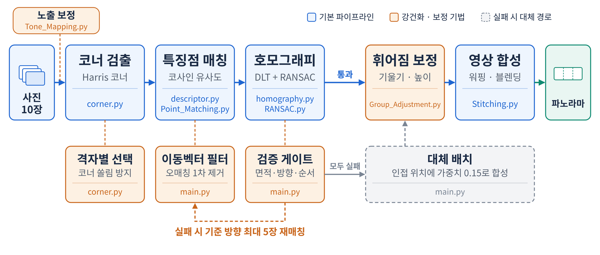
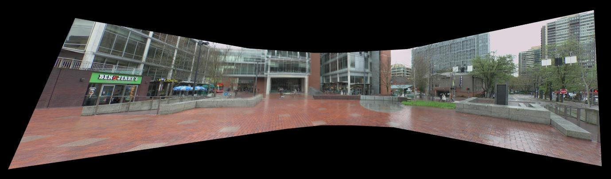
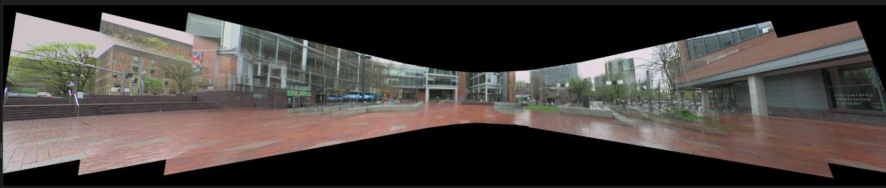
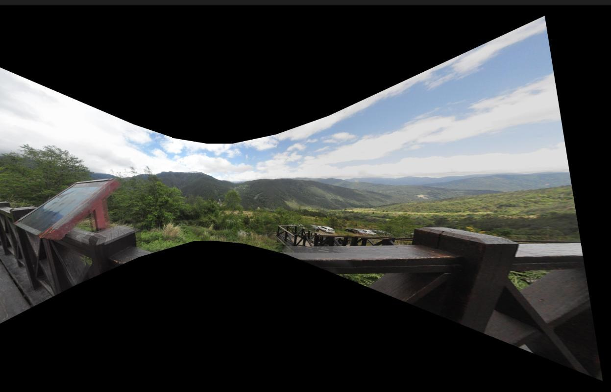
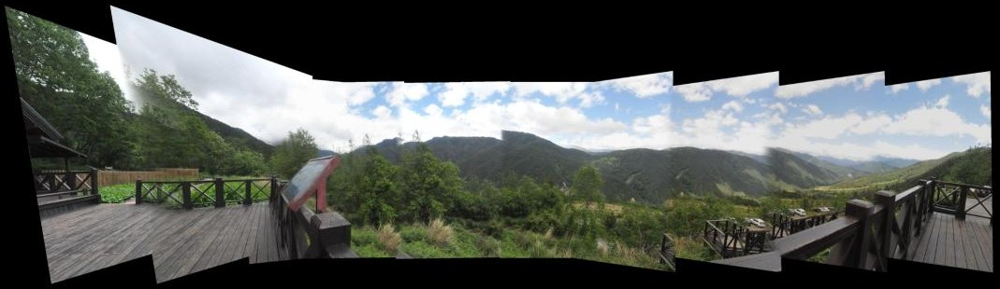

# 특징점 기반 파노라마 스티칭

여러 장의 사진을 기준 사진의 좌표계로 정렬해 한 장의 파노라마로 합성합니다.
**OpenCV를 쓰지 않고** NumPy와 PIL만으로 코너 검출, 디스크립터 매칭, 호모그래피 추정(Normalized DLT + RANSAC), 역방향 워핑, 블렌딩, 노출 보정까지 직접 구현했습니다.



## 목차

1. [파이프라인](#1-파이프라인)
2. [문제와 원인 → 해결 과정 → 결과](#2-문제와-원인--해결-과정--결과)
   - [2.1 코너 검출: 10장 중 3장이 빠짐](#21-코너-검출-10장-중-3장이-빠짐)
   - [2.2 매칭: 반복 무늬에서 체인이 끊김](#22-매칭-반복-무늬에서-체인이-끊김)
   - [2.3 합성: 밝기 차이·고스트·휘어짐](#23-합성-밝기-차이고스트휘어짐)
3. [실행 방법](#3-실행-방법)
4. [파일 구성](#4-파일-구성)
5. [다음 단계](#5-다음-단계)

---

## 1. 파이프라인

| 단계 | 구현 내용 | 파일 |
|---|---|---|
| **노출 보정** | 사진별 평균 밝기를 전체 평균에 맞추는 Gain 보정 (0.7\~1.3으로 제한) | `Tone_Mapping.py` |
| **전처리** | RGB → Gray(0.299R + 0.587G + 0.114B), 5×5 Gaussian blur (2D convolution 직접 구현) | `preprocess.py` |
| **코너 검출** | Sobel gradient → Structure tensor → Harris response `R = det(M) − k·trace(M)²` (k = 0.04) → NMS | `corner.py` |
| **디스크립터** | 코너 주변 11×11 패치를 벡터화, Z-score 정규화 후 L2 정규화 | `descriptor.py` |
| **매칭** | Cosine similarity + Lowe's ratio test + Cross-check | `Point_Matching.py` |
| **호모그래피** | 좌표 정규화 후 DLT(SVD), RANSAC으로 이상치 제거 후 inlier로 재추정 | `homography.py`, `RANSAC.py` |
| **검증·체인 정렬** | 이동벡터 사전 필터, H 기하 검증, 기준 사진 방향 체인 매칭, 실패 시 대체 배치 | `main.py` |
| **휘어짐 보정** | 사진 중심점 추세선으로 전체 기울기 보정, 기준 사진 높이에 맞춰 수직 정렬 | `Group_Adjustment.py` |
| **합성** | 역방향 워핑 + Bilinear 보간, Feathering 가중치 + Dominance rule 블렌딩, 감마 보정 | `Stitching.py`, `Tone_Mapping.py` |

기준 사진은 가운데 사진(10장이면 6번째)이고, 나머지 사진은 기준 사진 쪽으로 이어지는 호모그래피를 곱해 기준 좌표계로 옮깁니다.

---

## 2. 문제와 원인 → 해결 과정 → 결과

### 2.1 코너 검출: 10장 중 3장이 빠짐

**문제와 원인**
- 광장 사진 세트에서 10장 중 1, 2, 10번 사진이 파노라마에서 빠졌습니다.
- `non_maximum_suppression`에서 `threshold_ratio`가 실제로 적용되지 않는 버그가 있어, 하늘이나 바닥 같은 평탄한 영역의 약한 코너까지 대량으로 검출됐습니다.
- 응답값이 큰 순서대로만 코너를 고르면 텍스처가 강한 한쪽 영역에 코너가 몰려, 사진 사이에 겹치는 영역의 대응점이 부족해졌습니다.
- 처음에는 최소 inlier 수를 매칭 수의 10%로 잡았는데, 코너가 과다 검출되면서 이 기준이 지나치게 높아져 필요한 사진까지 탈락했습니다.

**해결 과정**
- NMS에서 `R ≤ threshold_ratio × max(R)`인 점을 실제로 제외하도록 수정했습니다.
- **Grid-based 선택:** 후보가 상한(1,500개)을 넘으면 사진을 8×12 격자로 나누고, 칸마다 응답값이 큰 코너를 고르게 뽑습니다.
- **적응형 임계값:** 250개 확보를 목표로 임계값을 0.01 → 0.007 → 0.005 → 0.003 → 0.002 → 0.001 순으로 낮추면서 NMS 반경(3 → 2)도 함께 조정합니다. 정해진 후보를 순서대로 시도하는 방식이라 무한 반복하지 않습니다.
- 최종 코드는 inlier 절대 하한 8개와, 사전 필터 후 대응점 대비 inlier 비율 12%를 함께 기준으로 씁니다.

**결과**
- 광장 세트에서 **유실 이미지 3장 → 0장** (수정 전후 비교 사례, 최종 출력 기준)

| 수정 전 (1·2·10번 유실) | 수정 후 |
|---|---|
|  |  |

### 2.2 매칭: 반복 무늬에서 체인이 끊김

**문제와 원인**
- 창문·벽돌 같은 반복 패턴에서 오매칭이 발생해, 이웃 사진과의 매칭이 실패했습니다.
- 매칭에 실패해 가중치가 0이 된 사진은 캔버스 계산에서 완전히 사라졌습니다. 인접한 한 장과만 매칭을 시도하면, 한 쌍이 실패할 때 그 뒤 체인 전체가 끊겼습니다.

**해결 과정**
- **이동벡터 사전 필터:** 파노라마 촬영에서 인접 사진 사이의 이동은 대체로 같은 방향이라는 점을 이용했습니다. RANSAC 전에 대응점 이동벡터 (dx, dy)의 중앙값에서 3.5 MAD 이상 벗어난 점을 1차로 제거합니다.
- **매칭 조건 단계적 완화:** ratio test 임계값을 0.7부터 단계적으로 완화하고 RANSAC 임계값 4 → 10 → 30 px를 조합해 차례로 시도한 뒤, `inlier² ÷ 중앙 재투영 오차` 점수가 가장 높은 결과를 고릅니다.
- **H 기하 검증 (검증 게이트):** 다음 중 하나라도 어긋나면 그 H를 버립니다. 원근 성분과 행렬식 조건은 사진 쌍 사이의 H에 적용합니다.
  - 원근 성분 크기 ≤ 0.002
  - 선형부 행렬식이 0.05\~20 범위
  - 투영된 네 모서리의 동차좌표 부호가 모두 같음
  - 투영 전후 면적비가 상한 이내
  - 이동 방향이 기준 사진 쪽과 일치
  - 사진 중심의 좌우 순서가 뒤바뀌지 않음
- **체인 재매칭:** 기준 사진과의 직접 매칭이 실패하면, 기준 사진 방향으로 **최대 5장**까지 이웃을 탐색해 점수가 가장 높은 쌍을 고르고 호모그래피를 이어 곱합니다.
- **대체 배치:** 그래도 모든 후보가 실패하면, 인접 사진 위치에서 사진 폭의 0.9배만큼 옆으로 옮긴 위치에 **가중치 0.15**로 배치합니다. 이 대체 변환은 검증 게이트를 거치지 않습니다.

**결과**
- 자연 세트 **10장 모두 캔버스에 배치**
- 최종 정렬에 실패한 사진은 인접 위치에 가중치 0.15로 배치됩니다. 정합이 아니라 소실 방지를 위한 처리입니다.

| 수정 전 (체인 끊김으로 사진 소실) | 수정 후 (최종 출력, 대체 배치 포함) |
|---|---|
|  |  |

### 2.3 합성: 밝기 차이·고스트·휘어짐

**문제와 원인**
- 사진마다 노출이 달라 이음매에서 밝기가 끊겼습니다.
- 겹치는 영역에서 정렬 오차가 있으면 같은 물체가 두 번 보이는 고스트가 생겼습니다.
- 호모그래피를 이어 곱할수록 오차가 누적돼 파노라마 전체가 기울거나 휘었습니다.

**해결 과정**
- **노출 보정:** 사진별 평균 밝기로 Gain을 계산해 전체 평균에 맞춥니다. 급격한 변화를 막기 위해 Gain을 0.7\~1.3으로 제한했습니다.
- **블렌딩:**
  - Feathering: 사진 가장자리로 갈수록 가중치를 줄입니다(가장자리 거리 비율의 1.5제곱).
  - Dominance rule: 새 가중치가 기존 누적 가중치의 절반을 초과할 때만 반영해 고스트를 줄입니다.
  - 매칭 신뢰도가 낮은 사진은 전역 가중치를 낮춰 합성에 덜 반영합니다.
- **휘어짐 보정:** 투영된 사진 중심점들에 1차 추세선을 맞춰 전체 기울기를 회전으로 보정(최대 ±10°)하고, 각 사진 중심을 기준 사진 높이에 맞춥니다.
- **워핑:** 캔버스 픽셀을 원본 사진 좌표로 역투영해 Bilinear 보간으로 샘플링하고, 메모리 사용을 줄이기 위해 행 블록 단위(약 500만 픽셀)로 처리합니다.
- 마지막으로 감마 1.1을 적용합니다.

**결과**
- 광장·자연 두 세트 모두 출력
- 이미지 누락 방지를 우선하고, 광장 세트의 디테일 저하는 감수했습니다. 특정 텍스처에 맞춰 조정했던 이전 설정보다 다양한 장면에서 사진이 빠지지 않는 쪽을 택했습니다.

---

## 3. 실행 방법

```bash
pip install numpy pillow        # Python 3.10 이상

# cv_prj/img_data/ 에 testimg1.jpg ~ testimg10.jpg 를 넣은 뒤
cd panorama-stitching
python cv_prj/main.py           # 결과: cv_prj/results/result.jpg
```

- 사진은 왼쪽에서 오른쪽 순서로 번호를 붙입니다. 장수를 바꾸려면 `main.py` 하단의 `num_images`를 수정합니다.
- 합성곱과 NMS를 순수 Python 반복문으로 구현해, 고해상도 사진에서는 실행 시간이 깁니다.
- 개발 초기에 쓰던 2장(`build_panorama_two_images`)·3장(`build_panorama_three_images`) 버전 함수도 실험용으로 남겨 두었습니다. 메인 경로는 N장 버전(`build_panorama_n_images`)입니다.

## 4. 파일 구성

```
cv_prj/
├── main.py              # N장 파이프라인, H 검증, 체인 매칭, 대체 배치
├── io_utils.py          # PIL 기반 입출력
├── preprocess.py        # Gray 변환, Gaussian kernel, 2D convolution
├── corner.py            # Sobel, Harris response, Grid NMS
├── descriptor.py        # 패치 디스크립터, 정규화
├── Point_Matching.py    # Cosine 매칭, ratio test, cross-check
├── homography.py        # Normalized DLT, 재투영 오차
├── RANSAC.py            # RANSAC 호모그래피
├── Group_Adjustment.py  # 기울기·수직 보정
├── Stitching.py         # 캔버스 계산, 역방향 워핑, 블렌딩
├── Tone_Mapping.py      # 노출 Gain 보정, 감마 보정
├── img_data/            # 입력 사진 위치
└── results/             # 출력 위치
```

## 5. 다음 단계

- **원통 투영:** 시야각이 넓은 장면을 평면 하나에 투영하면 양 끝이 크게 늘어납니다. 원통 좌표로 먼저 투영하면 넓은 장면에서도 왜곡을 줄일 수 있습니다.
- **겹침 영역 기반 노출 보정:** 사진 전체 평균 대신 겹치는 영역의 밝기 차이로 Gain을 구하면 이음매가 더 자연스러워집니다.
- **회전·스케일 불변 디스크립터:** 패치 디스크립터를 방향 정규화·다중 스케일 디스크립터로 바꾸면 반복 무늬와 시점 변화에 더 강해집니다.
